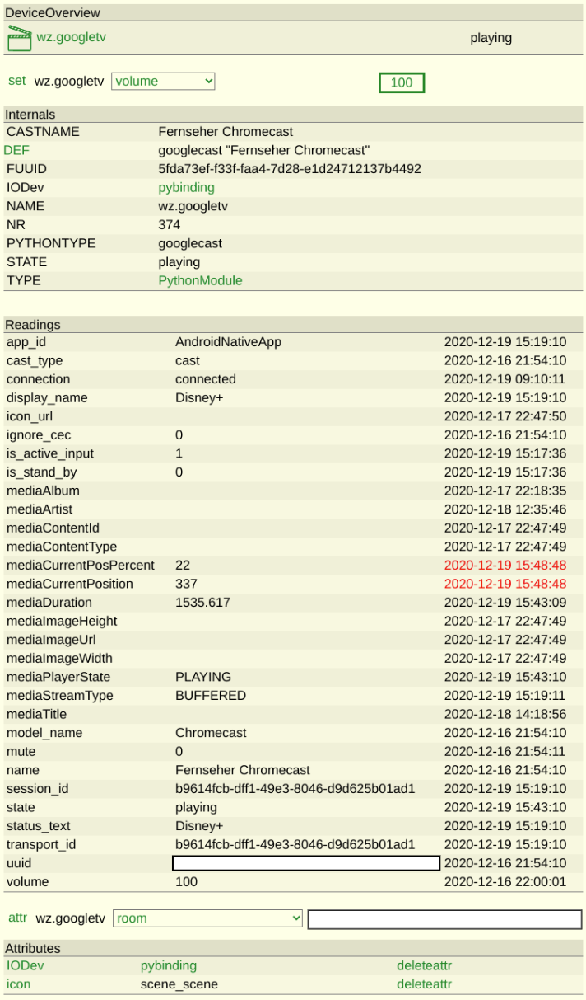

# Google Cast module for all cast enabled devices
This module can be used to control cast enabled devices like Google Home, Nest Hub Max, Nest Home, Chromecast, .... Every device which supports the cast protocol should be controlable.

## Usage
```
define cast fhempy googlecast <NAME>
```

 - NAME: Name of the cast device (e.g. "Living Room"). You need to use quotes if the name contains spaces.

As soon as the device is online you can connect your Spotify account. See the attributes section below.

```
set cast play url=https://open.spotify.com/artist/4PBCFEjR4a3OGdOZ6jeKKM
```

## Commands
 - addToQueue
 - alarm: Plays a siren like an alarm system. Devices with a screen (e.g. Nest Hub, Chromecast) show the text with an alarm picture. All parameters are optional:
   - text: Message to show, default "Alarm"
   - duration: Seconds the alarm sound plays (1-600), default 30
   - volume: Volume (0-100) for the alarm, the previous volume is restored afterwards

   E.g. `set dev alarm`, `set dev alarm "Water in the basement"` or `set dev alarm "Smoke detected" duration=120 volume=90`. `set dev stop` ends the alarm early.
 - displayWebsite: Uses dashcast to display a website on Chromecast, NestHub or other cast devices
 - next
 - pause
 - play: E.g. set dev play url=https://url.to.youtube or set dev play to just resume playback. URLs other than YouTube will be played in the default media renderer. It might take some seconds for the video stream to show up.
 - playFavorite
 - prev
 - quitApp
 - rewind
 - seek
 - skip
 - speak: E.g. set dev speak Good morning (quotes are not needed). Long texts are split into parts and joined to one announcement. Devices with a screen (e.g. Nest Hub) show the text (shortened) and the fhempy icon.
 - speakDisplay: Speaks the first text and shows the second one on the screen, e.g. set dev speakDisplay "Today it will be sunny with up to 25 degrees..." "Weather today"
 - startApp
 - stop
 - subtitles
 - volDown
 - volUp
 - volume

 ## Attributes
  - speak_lang: Language of speak and speakDisplay (default de).
  - speak_port: fhempy serves announcements and the icon to the cast device via HTTP on this port. 0 (default) picks a free port, set a fixed port if a firewall is in between.
  - spotify_sp_dn: Set this attributes to the cookie content of sp_dn found here chrome://settings/cookies/detail?site=spotify.com. You need to login to Spotify webclient first https://open.spotify.com/.
  - spotify_sp_key: Set this attributes to the cookie content of sp_key found here chrome://settings/cookies/detail?site=spotify.com. You need to login to Spotify webclient first https://open.spotify.com/.

## Screenshot
