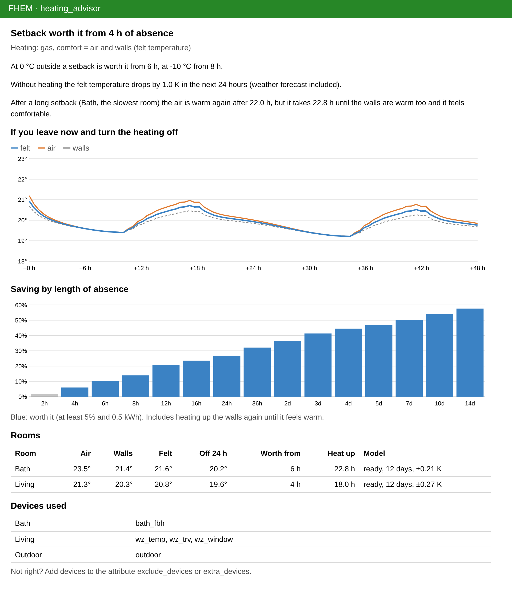

# Heating advisor

Is it worth turning the heating down when you leave for a day, a weekend or two weeks? The heating advisor learns
how your house keeps and loses heat and answers it for every absence, with the weather forecast:

- how cold it gets with the heating off, hour by hour (sun included)
- from how many hours or days of absence a setback saves energy
- how long it takes until it is warm again, and when to start heating up
- on request it sets the thermostats back and heats up in time



## Set up

```
define heating_advisor fhempy heating_advisor
```

Or use the *Heating advisor* tile in *Install modules*. Nothing else is needed: the module finds the room
temperatures, thermostats, valve positions, window contacts, the outdoor temperature and RESIDENTS by their rooms and
reading names. The device page lists the devices it uses (attributes `exclude_devices` and `extra_devices` if
something is wrong). The weather (outdoor temperature, sun) comes from [Open-Meteo](https://open-meteo.com), no
account needed, for the location in `attr global latitude/longitude`.

If an fhempy [timeline](../timeline/README.md) is defined, the measurements of the last 90 days are imported, so
the first answer is there after a few minutes. Otherwise the advisor needs a few nights; it learns best from times
when the heating was off or set back (night setback, warm days). `set heating_advisor learn_night` sets the heating
back by 4 K for one night as an experiment if that never happens.

## Felt temperature: air and walls

23 °C air feels cold if the walls are still at 15 °C: the body loses heat by radiation to the cold surfaces. The
advisor therefore works with the *felt* (operative) temperature, the mean of the air and the surfaces. After a
setback a room only counts as warm again when the felt temperature is back and the air is at most 3 K warmer than
the walls (`max_radiant_asymmetry`). Heating up the walls takes much longer than heating up the air and costs the
energy the walls lost; both are part of every calculation, also after you are back. `attr comfort_basis air` uses
only the air temperature.

## How it works

Every room gets a small physical model with two temperatures: the air (with furniture) and the thermal mass of
walls, floors and ceilings, connected by heat resistances like an electric circuit (grey-box 2R2C model). The values
are learned from the measurements every night (03:00) with a Kalman filter and maximum likelihood: heat loss to the
outside, how much heat the walls store, how much sun gets in through the east, south and west windows, the internal
gains when somebody is at home, what an open window costs and the heating power. Typical house values are used while
there are few measurements. A new model is only taken if it forecasts the last 7 days better than the old one.

During the day the Kalman filter follows the current state, including the temperature of the walls which is never
measured. A temperature drop much faster than the model expects is detected as open window in rooms without
window contacts, these times are not used for learning.

For a setback the advisor compares *keep heating* with *set back and heat up as late as possible*, tries several
setback temperatures and a short boost of the air while heating up, and counts the energy with the efficiency of the
heating: heat pumps need a higher flow temperature when they heat up fast, so a short setback can cost more power
than it saves.

## Readings

| Reading | Meaning |
|---|---|
| `state` | e.g. *setback worth it from 14 h* |
| `setback_worth_from_h`, `setback_worth_from_text` | from this absence a setback saves at least `worth_threshold_pct` (5 %) and `worth_threshold_kWh` (0.5 kWh), with the weather forecast |
| `setback_worth_from_h_at_0C`, `_at_m10C`, `_at_10C` | the same at constant outdoor temperatures |
| `savings_24h_kWh`, `savings_24h_pct`, `savings_24h_eur`, `savings_7d_*` | saving of an absence of 24 hours / 7 days |
| `best_setback_temp` | the setback temperature which saves most for 24 hours |
| `reheat_hours`, `reheat_hours_air` | heating up after a long setback until air and walls (felt) / only the air are warm |
| `forecast_off_1h` … `forecast_off_48h`, `forecast_off_7d` | felt temperature with the heating off from now |
| `forecast_off_min`, `forecast_off_min_time`, `forecast_off_below_frost` | lowest value in 48 hours, when the air falls below 5 °C |
| `operative_temp` | felt temperature now |
| `heat_loss_W_per_K`, `storage_kWh_per_K` | heat loss per degree difference inside/outside, heat stored per degree |
| `model_state`, `model_quality`, `model_updated` | learning, ready or good; forecast error of the last 7 days |
| `<room>_operative_temp`, `<room>_wall_temp`, `<room>_radiant_asymmetry_K` | felt temperature, estimated wall surface, air minus walls |
| `<room>_forecast_off_12h`, `_24h`, `<room>_setback_worth_from_h`, `<room>_best_setback_temp`, `<room>_reheat_hours` | the same per room |
| `<room>_time_constant_air_h`, `_mass_h`, `_heat_loss_W_per_K`, `_solar_gain_factor_m2`, `_window_cost_W_per_K`, `_window_open_detected` | what was learned |
| `plan_*` | result of `set absence` |

Energies in kWh need the heating power (`attr heating_power_kW`, e.g. 9 for a 9 kW heat pump), otherwise they are
rough estimates (reading `energy_basis`). Hours and percentages don't need it.

## Commands

- `set heating_advisor absence 3d` computes an absence from now (also `36h`, `07:30`, `2026-12-27_18:00`): readings
  `plan_worth`, `plan_saving_kWh`, `plan_setback_temp`, `plan_reheat_start`
- `set heating_advisor absence 2026-12-27_18:00 apply` also does it: the thermostats are set back now and heat up in
  time for your return (each room at its own time). `set heating_advisor cancel` sets them back to comfort now
- `set heating_advisor heat_up_at 06:30`: the house is set back already, heat up as late as possible
- `set heating_advisor learn_night`: learning experiment tonight
- `get heating_advisor forecast 24 [setpoint]`: hourly forecast of all rooms as JSON, heating off or at setpoint
- `get heating_advisor model`: learned values as JSON

Thermostats with their own weekly program may overwrite the setback with their next switching time.

## Attributes

| Attribute | Default | Meaning |
|---|---|---|
| `rooms` | all | rooms to use, comma separated |
| `exclude_devices`, `extra_devices` | | devices not to use / to use in addition |
| `outdoor_sensor` | found by name | device or device:reading, otherwise Open-Meteo |
| `heating_type` | auto | heatpump, gas, oil, electric, district |
| `floor_heating` | auto | auto (by names like FBH, floor), all, none or rooms |
| `heating_power_kW` | | maximum heating power, for kWh and € |
| `comfort_temp` | usual setpoint | comfort setpoint |
| `setback_temp` | auto | setback temperature, auto tries several |
| `min_temp` | 12 | never colder during a setback |
| `comfort_basis` | operative | operative (air and walls) or air |
| `max_radiant_asymmetry` | 3 | max. air minus walls in K when warm |
| `price_kWh` | | price as number or device:reading |
| `worth_threshold_pct`, `worth_threshold_kWh` | 5, 0.5 | from when a setback is worth it |
| `history_days` | 60 | days of measurements to learn from |

The data is stored in `.fhempy/heating_advisor/<name>.db`. All calculations run in pure Python on the fhempy host,
no cloud except the weather.
