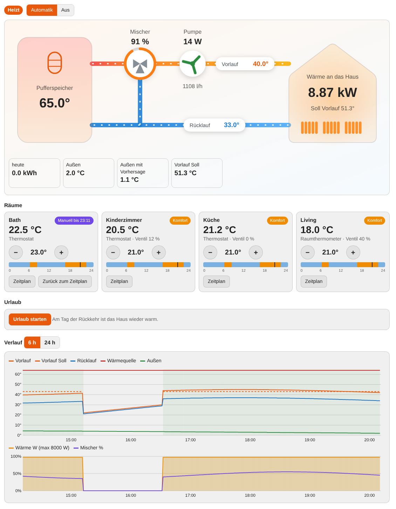

# Heating control

Controls one heating circuit: the **mixer** (0-100 %) which mixes the hot supply of the heat
source down to the flow temperature the house needs, the **circulation pump** (on/off) and all
**room thermostats**. The heat source itself (boiler, buffer tank, heat pump) is not touched.

- **Very simple schedules per room**: comfort periods on a 24 h bar, tap or swipe, the rest of
  the day is eco. Presets (work day, home all day), Mo-Fr / Sa-Su or single days, one tap to
  use the schedule for all rooms.
- **Change a room for now**: − / + on the detail page or simply turn the thermostat. The room
  keeps the temperature until its next schedule change.
- **Vacation in one tap**: choose the day you are back (or 1 week / 2 weeks), on that day the
  house is warm again.
- **Room thermometers**: where a thermometer is in the room, its temperature counts. The
  module learns how much warmer the thermostat at the radiator measures and corrects its setpoint.
- **Learning flow temperature**: starts with the usual radiator heating curve and learns a
  correction per outdoor temperature (every 5 K): rooms which stay too cold raise it, warm rooms
  with mostly closed valves lower it. The weather forecast of the next hours is included, the
  house reacts slowly.
- **Live diagram and chart**: supply, mixer, pump, flow, return, the heat delivered to the house
  in W and kWh per day.
- **Event based**: every new value of a sensor or thermostat triggers a control step, a timer
  only wakes up at the next schedule change (and every 5 minutes while the pump runs, in case a
  sensor only reports changes). Nothing polls the devices.

## Define

`define heizung fhempy heating_control`

After define the module **controls nothing**. Open the detail page: a setup assistant goes
through everything step by step (heat source, mixer, pump, flow and return, rooms, weather).
Every device is chosen in a search field (type a part of the name, alias or room), the module
suggests devices where it can. Thermostats are found automatically (a temperature reading and a
set command for the target temperature). Their FHEM room is only suggested, each thermostat can
get its own room, thermostats with the same room are controlled together. At the end an overview
shows what will be switched, only **Start control** starts the control (`set <name> mode auto`).

| Setup | Example |
|---|---|
| Mixer | a Shelly with `pct`/`position`/`brightness` 0-100 (e.g. MQTT2_DEVICE) |
| Circulation pump | a switchable device with `on`/`off`, ideally measuring its power |
| Flow / return / heat source temperature | device and reading, one device may deliver all of them |
| Type of heat source | buffer tank, heat pump, wood stove, pellets, gas, oil, district heating, solar (picture and name) |
| Outdoor temperature | optional, otherwise the weather device |
| Weather | found automatically: `openmeteo_weather` (recommended), `Weather`, ... |
| Pump type and setting | all Grundfos ALPHA types, AUTOADAPT, PP1-3, CP1-3, I/II/III |

## Heat delivered to the house

`heat = flow (l/h) × 1.144 × (flow temperature − return temperature)`

The flow is estimated from the power of the pump: on a given setting a Grundfos ALPHA runs on a
known curve and takes more power with more flow. The power comes from the switch of the pump
(e.g. `apower` of a Shelly) or from attribute `pump_power` (the value on the display of the
pump). The pump curves are approximations from the data sheets, expect about ±25 %. With a
heat meter use `flow_factor` to calibrate, or `fixed_flow` for a known flow.

## Readings

| Reading | Description |
|---|---|
| `state` | `setup: <missing>` or `setup: ready to start` (nothing is controlled), `heating`, `warm` (all rooms warm, pump off), `summer`, `frost`, `vacation`, `off` |
| `flow_temp`, `flow_target` | flow temperature and its target |
| `return_temp`, `supply_temp` | return and heat source (before the mixer) |
| `outdoor_temp`, `outdoor_effective` | outdoor temperature, with forecast |
| `mixer`, `pump`, `pump_power`, `flow_rate` | mixer %, pump on/off, W, estimated l/h |
| `heat_power`, `heat_today`, `heat_energy` | heat to the house in W, kWh today, kWh total |
| `room_<room>_temperature`, `_target`, `_state`, `_valve` | per room, state `comfort`, `eco`, `manual`, `vacation`, `window` |
| `room_<room>_schedule`, `_comfort`, `_eco`, `_override` | the settings of the room (saved in the FHEM state file) |
| `learned_curve` | learned correction per outdoor temperature: `outdoor:offset:hours` |
| `vacation` | `off` or `<day back> <temperature>` |

## Set

- `mode setup|auto|off`: `setup` (after define) and `off` only measure and control nothing,
  `auto` starts the control, only with a finished setup.
- `room_temp <room> <temperature>|auto`: temperature until the next schedule change.
- `comfort_temp <room>|all <temperature>`, `eco_temp <room>|all <temperature>`
- `schedule <room> <schedule>`: comfort periods, e.g.
  `set heizung schedule Wohnzimmer Mo-Fr 06:00-08:00,16:00-22:00; Sa-So 07:00-23:00`
  (German or English day names, `-` = eco all day).
- `copy_schedule <from> <to>|all`
- `vacation <day back> [temperature]`: e.g. `2026-12-27`, `27.12.` or `7d`.
- `vacation_off`, `reset_learning`, `rescan`

## Attributes

- `mixer`, `pump`, `flow_sensor`, `return_sensor`, `supply_sensor`, `outdoor_sensor`, `weather`,
  `thermometers`: set from the detail page.
- `mixer_invert 1`: 0 % means full supply.
- `mixer_step` (2 %), `mixer_interval` (30 s): smallest change and time between two mixer commands.
- `pump_model`, `pump_setting`, `pump_power`, `flow_factor`, `fixed_flow`: flow estimate.
- `design_flow` (55 °C, 35 for floor heating) and `design_outdoor` (-12 °C): start of the heating curve.
- `min_flow` (20 °C), `max_flow` (60 °C, use 45 or less for floor heating!).
- `heating_limit` (16 °C): no heating from this outdoor temperature on (with forecast).
- `forecast_hours` (6): hours of the forecast used.
- `comfort_default` (21), `eco_default` (18), `vacation_default` (16)
- `exclude_thermostats`: thermostats which the module leaves alone.
- `thermostat_rooms`: own rooms instead of the FHEM rooms, `thermostat=room,...` (set by the assistant).

## Safety

- The pump runs at least 10 minutes and stays off at least 10 minutes.
- Frost: below 5 °C in flow or return the pump runs and the mixer opens.
- The flow temperature never exceeds `max_flow`.
- Other heating modules (e.g. one which only advises on setbacks) can run next to it.
