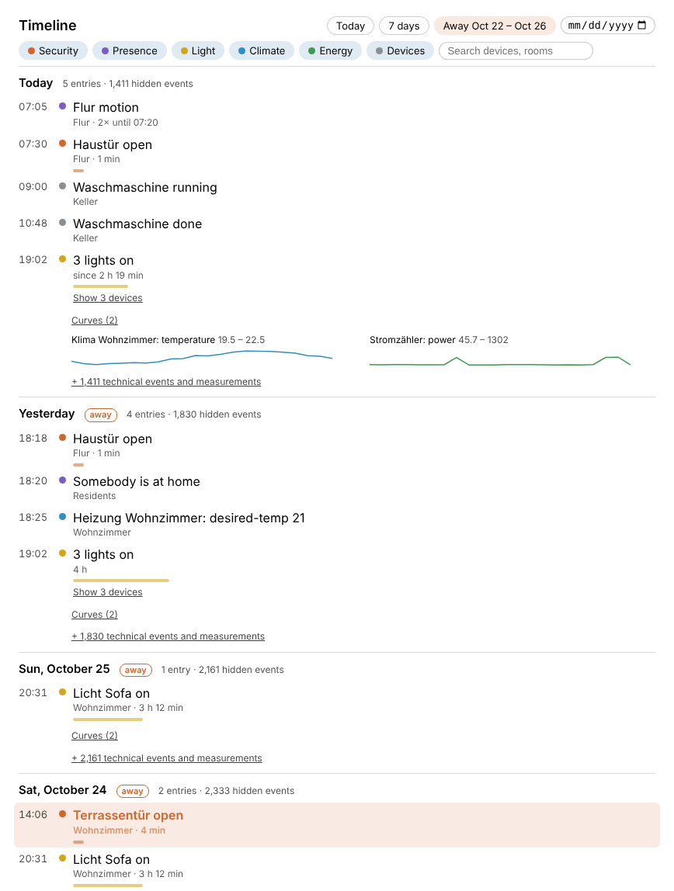

# Timeline

See what happened at home, e.g. during your holidays. fhempy records the events of all FHEM devices and shows them
on the device page as a story per day, newest first:

- doors and windows, locks, motion, lights, thermostats and who came home or left
- *on* and *off* become one entry with a duration ("Light sofa on, 3 h 12 min")
- repeats are bundled ("Hallway motion, 14× until 09:15")
- devices switched together, e.g. by a scene, become one entry ("3 lights on")
- days without anything to tell are merged into one line
- while nobody is at home (RESIDENTS absent or gone), opened doors and motion are highlighted, smoke and water alarms
  always
- absences of a day or more are offered as buttons, e.g. *Away Aug 12 – Aug 26*



## Set up

```
define timeline fhempy timeline
```

Or use the *Timeline* tile in *Install modules* of the fhempy device. Then open the device `timeline`: that's it,
the timeline fills up as soon as something happens at home. The device is put into the room *Timeline*.

The FHEM modules of fhempy have to be up to date (`update all`, restart FHEM), otherwise the state says
*FHEM update needed*.

## Without technical noise

Every reading lands in one of three layers, nothing has to be configured:

| Layer | What | Shown as |
|---|---|---|
| Story | contact, motion, presence, lock, alarm, the state of lights and switches, desired temperature... | one line per change |
| Curves | numbers like temperature, humidity, power, energy | small curves per day (min/max per hour) |
| Technical | signal strength (RSSI, linkquality), last seen, voltages, versions, uptime, other text readings | hidden, "+ 1,411 technical events and measurements" |

fhempy decides by the name of the reading, its value (few fixed values or numbers), how often it changes and the
device: notify, at, DOIF, FileLog, gateways and dummies without room are never part of the story. A reading which
changes more than 60 times per hour is hidden automatically (not for doors, motion and presence, these are bundled).
The most frequent technical events (RSSI, linkquality, last seen...) are only counted by FHEM and never sent to
fhempy.

If something is wrong:

- **Show less** next to an entry hides this reading (attribute `hidden`)
- **Always show** in the list of hidden events of a day shows a reading in the story (attribute `always_show`)
- `set timeline auto <device>:<reading>` lets fhempy decide again

## Storage

Everything is stored in `.fhempy/timeline/<device name>.db` (SQLite) in the FHEM directory, no database server or
DbLog needed. The story and the daily curves are kept for 2 years (`keep_days`), hidden events for 14 days
(`keep_details_days`). Writes are collected for 5 seconds to protect the SD card.

## Attributes

| Attribute | Default | |
|---|---|---|
| hidden | | readings which are never shown, e.g. `Hallway:motion Sensor1:*` |
| always_show | | readings which are always shown, e.g. `Washer:program` |
| skip_events | | regexp of events (`device:reading: value`) FHEM doesn't send at all |
| keep_days | 730 | days the story and curves are kept |
| keep_details_days | 14 | days hidden events are kept |

## Readings

- `state`: recording, starting or what is wrong
- `story_events_today`, `hidden_events_today`
- `last_story`: text of the last story event, e.g. for a notify
- `database_size`

`get timeline entries [YYYY-MM-DD] [YYYY-MM-DD]` returns the timeline as JSON, `get timeline details YYYY-MM-DD`
the hidden events of a day.
